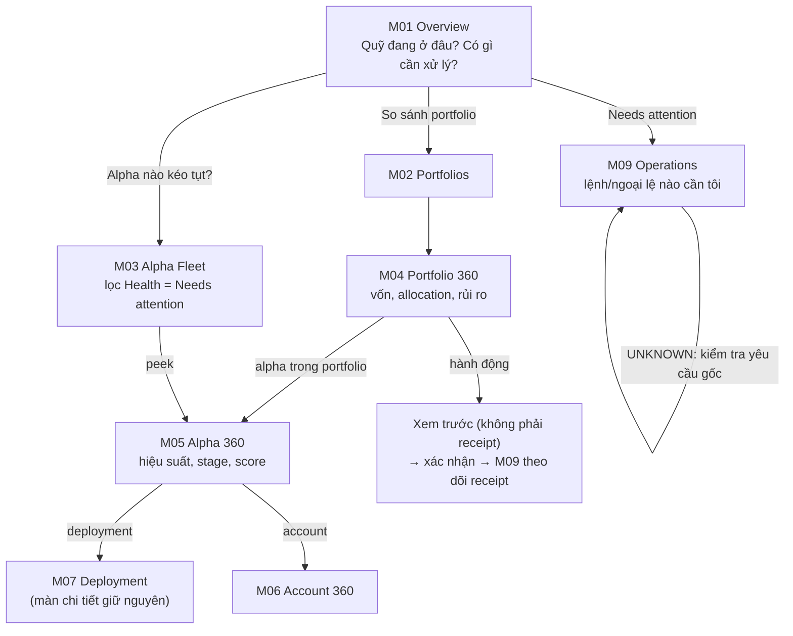
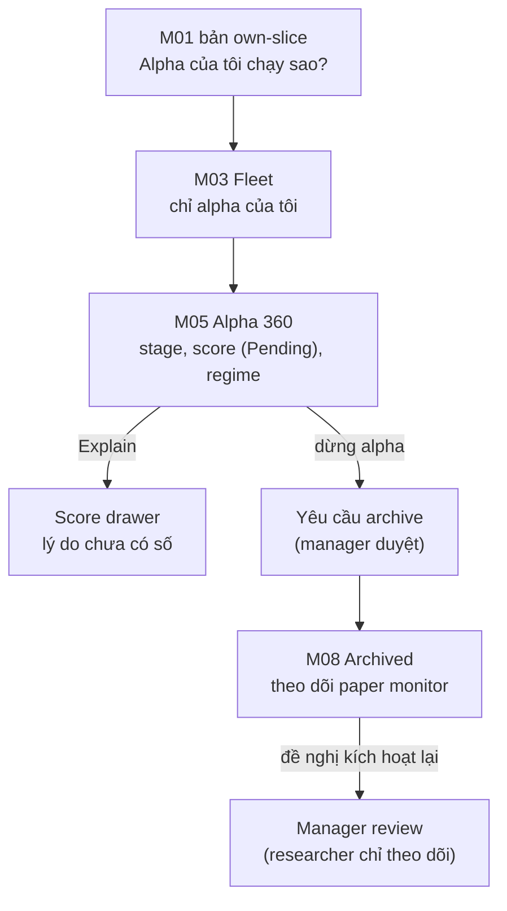
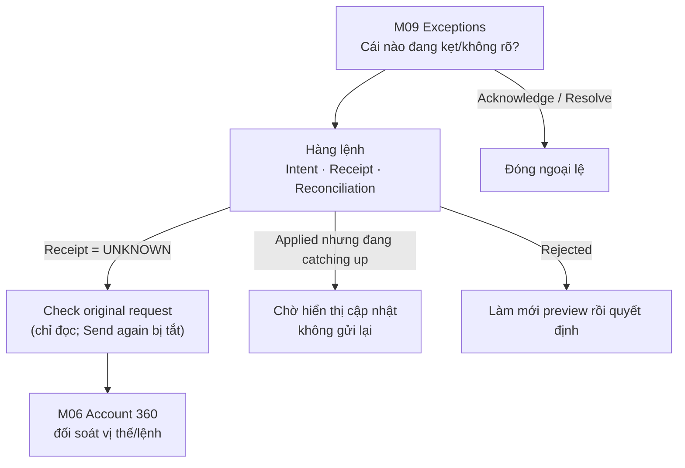
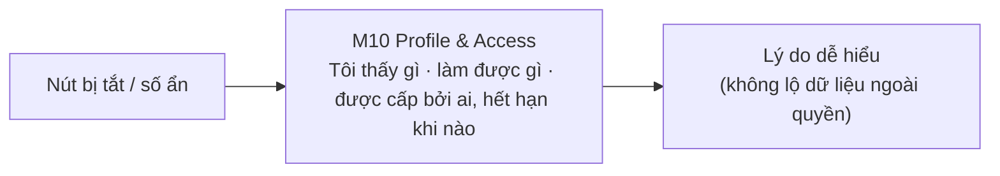

# UXM-02 — Luồng người dùng theo persona (nháp, Claude)

Mỗi luồng cho biết người dùng **hỏi gì ở mỗi bước**, màn nào trả lời, và **quyết định gì** kế tiếp. Mã M01–M10 là các màn lowfi trong [lowfi/](lowfi/).
Nguyên tắc: tối đa 3 lần bấm từ Overview tới câu trả lời; ngữ cảnh (môi trường, cửa sổ, bộ lọc) đi theo URL nên Back luôn về đúng chỗ.

## 1. Manager (đọc toàn quỹ)

## 2. Researcher (chỉ lát của mình)

## 3. Operator (xử lý sự cố/lệnh)

## 4. Người dùng hỏi "vì sao tôi không thấy/không làm được?"

## Quyết định của Bobby (2026-10-17, tất cả theo khuyến nghị UX)

| # | Quyết định |
| --- | --- |
| F1 | Manager **không** đi tắt từ Overview tới màn deployment; luôn qua Alpha/Account để giữ ngữ cảnh. Needs attention trỏ tới Operations hoặc Alpha/Account, không tới deployment |
| F2 | Hành động vốn (grant, recall, đặt mục tiêu ngân sách) **chỉ bắt đầu từ Portfolio 360 (M04)**; Operations chỉ theo dõi receipt |
| F3 | Researcher bấm **Request archive ở Alpha 360**; manager duyệt trong hàng chờ ở **Operations & Decisions**; tái kích hoạt chỉ manager |
